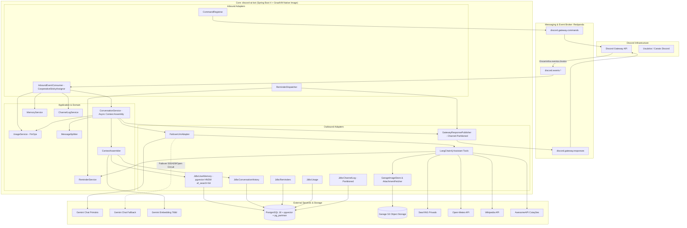

# 🤖 Discord AI Bot

[](https://openjdk.org/)
[](https://www.graalvm.org/)
[](https://spring.io/projects/spring-boot)
[](https://github.com/langchain4j/langchain4j)
[](https://github.com/pgvector/pgvector)
[](https://redpanda.com/)
[](https://resilience4j.readme.io/)

O **Discord AI Bot** é um microserviço de inteligência artificial de alto desempenho, contextual e orientado a eventos para comunidades no Discord. Desenvolvido sobre **Java 25**, compilado nativamente com **GraalVM Native Image** e orquestrado com **Spring Boot 4**, ele adota os princípios de **Arquitetura Hexagonal (Ports and Adapters)** e integração assíncrona desacoplada via cluster **Redpanda / Kafka**.

O serviço integra os modelos da família **Google Gemini** com recuperação de memória semântica vetorial de longo prazo (**pgvector** com indexação HNSW), particionamento e retenção temporal automatizados via **`pg_partman`**, ferramentas dinâmicas de busca com proteção corporativa **anti-SSRF**, controle orçamentário granular (**FinOps**) e alta disponibilidade com failover automático e virtual threads.

---

## 🏛️ Blueprint da Arquitetura

O sistema opera de forma 100% desacoplada do Discord: um gateway externo recebe os eventos do Discord Gateway API e os publica em tópicos Kafka. O `discord-ai-bot` consome os eventos, monta o contexto de forma paralela usando Virtual Threads, realiza a inferência com chamadas a ferramentas e devolve as respostas formatadas particionadas por canal para manter estrita ordenação FIFO.

### 📐 Diagrama de Componentes e Arquitetura Hexagonal



---

## ⚡ Fluxo de Execução Ponta a Ponta

Cada mensagem ou interação passa por um pipeline com validação de duplicidade, limites de custo, montagem concorrente de contexto, inferência e publicação ordenada:

```mermaid
sequenceDiagram
    autonumber
    actor User as Usuário (Discord)
    participant GW as Discord Gateway
    participant Redpanda as Redpanda (Kafka)
    participant Bot as InboundEventConsumer
    participant CS as ConversationService
    participant DB as PostgreSQL (pgvector + partman)
    participant S3 as Garage S3
    participant Gemini as FailoverLlmAdapter (Gemini)

    User->>GW: Mensagem ou Comando (/ia, .ia, menção ao bot)
    GW->>Redpanda: Publica evento em discord.events.*
    Redpanda->>Bot: Consumo concorrente com commit manual e CooperativeStickyAssignor
    
    rect rgb(240, 248, 255)
    Note over Bot,CS: 1. Validação & Controle Orçamentário (FinOps)
    Bot->>Bot: Deduplicação transacional (ai_bot.processed_events)
    Bot->>Bot: Rate limit em memória (6 req/min) e teto diário/mensal (UsageService)
    alt Limite atingido
        Bot->>Redpanda: Publica aviso amigável efêmero/direto
    end
    end

    rect rgb(255, 250, 240)
    Note over Bot,GW: 2. Feedback Imediato
    Bot->>Redpanda: Envia placeholder "Pensando..." no canal
    Redpanda->>GW: Exibe digitação / placeholder inicial
    end

    rect rgb(245, 255, 245)
    Note over CS,DB: 3. Montagem Concorrente de Contexto (Virtual Threads)
    par Histórico de Sessão
        CS->>DB: Busca últimos turnos (ai_bot.conversation_turns)
    and Memória Semântica
        CS->>Gemini: Gera embedding da pergunta (768 dimensões)
        CS->>DB: Busca vetorial HNSW (SET LOCAL hnsw.ef_search = 64)
    and Anexos de Mídia
        CS->>S3: Download seguro com limite de bytes e validação de magic bytes
    end
    CS->>CS: ContextAssembler monta o prompt estruturado
    end

    rect rgb(255, 245, 245)
    Note over CS,Gemini: 4. Inferência com Ferramentas & Resiliência
    CS->>Gemini: Envia prompt (preservando Thought Signatures)
    loop Até 5 chamadas sequenciais de ferramentas
        Gemini->>CS: Solicita Tool Call (ex: web_search, calculator, image_search)
        CS->>CS: Executa ferramenta isolada (CircuitBreaker + TimeLimiter + Anti-SSRF)
        CS-->>Gemini: Retorna resultado da ferramenta
    end
    alt Primário falha com 503, 429 ou Circuito Aberto
        Gemini->>Gemini: Failover transparente para modelo de contingência
    end
    Gemini-->>CS: Resposta AiAnswer + Token Usage
    end

    rect rgb(250, 240, 255)
    Note over CS,Redpanda: 5. Persistência e Publicação Ordenada
    CS->>CS: MessageSplitter divide texto em blocos de até 1900 caracteres
    CS->>DB: Persiste turnos no histórico e atualiza contabilidade de uso diário
    CS->>Redpanda: Publica chunks particionados por channelId (estrita ordem FIFO)
    Redpanda->>GW: Edita o placeholder e entrega a mensagem ao canal
    GW->>User: Exibe resposta formatada no Discord
    end
```



---

## 🛠️ Ferramentas Integradas (LangChain4j Assistant Tools)

O assistente possui 10 ferramentas de alta precisão invocadas sob demanda durante a inferência:

| Ferramenta | Descrição | Mecanismo | Resiliência & Segurança |
|---|---|---|---|
| `web_search` | Busca na web por fatos recentes, notícias e documentação atualizada. | Instância privada SearXNG | CircuitBreaker (30s) + TimeLimiter (5s) |
| `image_search` | Busca imagens na web, faz download concorrente e armazena para envio. | SearXNG + `SafeImageDownloader` + S3 | Anti-SSRF, máx 4 imagens, 8 MiB |
| `read_url` | Lê e resume o conteúdo textual de links web fornecidos pelo usuário. | `SafePageReader` + Jsoup + parser raw | Anti-SSRF completo, máx. 5 redirects, portas 80/443 |
| `channel_context` | Recupera mensagens recentes trocadas no canal para contexto imediato. | `JdbcChannelLog` (`ai_bot.channel_messages`) | Tabela particionada com retenção automática |
| `exchange_rate` | Cotações e conversão cambial de moedas fiduciárias e criptomoedas. | AwesomeAPI (`economia.awesomeapi.com.br`) | CircuitBreaker (60s) + TimeLimiter (5s) |
| `reminder` | Agenda lembretes no canal para serem disparados automaticamente. | `JdbcReminders` + `ReminderDispatcher` | Scheduler a cada 10s, suporte a fusos locais |
| `calculator` | Avaliador matemático de alta precisão para expressões numéricas. | `ExpressionCalculator` (Parser próprio) | Seguro, sem motores de script, sem injeção |
| `weather` | Condições climáticas e previsão do tempo de cidades globais. | Open-Meteo API | CircuitBreaker (60s) + TimeLimiter (4s) |
| `wikipedia` | Informações enciclopédicas estáveis e definições conceituais. | Wikipedia REST API v1 | CircuitBreaker (60s) + TimeLimiter (4s) |
| `save_memory` | Gravação voluntária de preferências e informações relevantes do usuário. | `JdbcUserMemory` + `GeminiEmbeddingAdapter` | Embedding 768d, Cosine Distance, dedup vetorial |

---

## 🛡️ Segurança Corporativa e Proteção Anti-SSRF

Ao interagir com a web aberta através de `read_url` e `image_search`, o bot aplica regras rigorosas contra **Server-Side Request Forgery (SSRF)** e exfiltração:

1. **Validação Estrita de IPs de Destino (`SafeImageDownloader` / `SafePageReader`)**:
   - Resolução DNS inspecionada antes de abrir conexões.
   - Bloqueio imediato de endereços:
     - Loopback (`127.0.0.0/8`, `::1`)
     - Redes Privadas RFC 1918 (`10.0.0.0/8`, `172.16.0.0/12`, `192.168.0.0/16`)
     - Link-Local (`169.254.0.0/16`, `fe80::/10`)
     - Carrier-Grade NAT (CGNAT `100.64.0.0/10`)
     - Unique-Local IPv6 (`fc00::/7`) e Multicast (`224.0.0.0/4`, `ff00::/8`)
     - Domínios de infraestrutura de cluster (`*.cluster.local`, `*.consul`, `*.internal`)
2. **Validação em Cada Salto de Redirecionamento**:
   - Não utiliza redirect automático de HTTP client. Cada salto (até 3 para imagens, 5 para páginas) é revalidado independentemente contra o resolvedor anti-SSRF.
3. **Restrição de Portas e Esquemas**:
   - Permite unicamente `http` e `https` nas portas `80` e `443`. URLs contendo credenciais (`user:password@host`) são rejeitadas.
4. **Inspeção de Formato por Magic Bytes**:
   - O tipo de imagem nunca é inferido por extensão de URL ou pelo cabeçalho `Content-Type`. Os primeiros bytes do payload são analisados para confirmar os magic numbers de formatos legítimos (`PNG`, `JPEG`, `GIF`, `WEBP`).
5. **Hardening de Contêiner e Pod no Kubernetes**:
   - Sistema de arquivos somente leitura (`readOnlyRootFilesystem: true`).
   - Bloqueio de elevação de privilégios (`allowPrivilegeEscalation: false`).
   - Desativação do token automático de ServiceAccount (`automountServiceAccountToken: false`).
   - Isolamento via `NetworkPolicy` liberando apenas tráfego para DNS, Consul, Vault, Redpanda, PostgreSQL, S3 e SearXNG.

---

## 🗄️ PostgreSQL Avançado: Particionamento com `pg_partman` e Busca Vetorial `pgvector`

O banco de dados foi modelado e tunado para suportar alto volume de mensagens e buscas semânticas sem degradação:

- **Particionamento Temporal Nativo (`pg_partman`)**:
  - As tabelas de alto volume `ai_bot.conversation_turns`, `ai_bot.sent_chunks` e `ai_bot.channel_messages` são particionadas por range temporal (`PARTITION BY RANGE (created_at)`).
  - O `pg_partman` gerencia automaticamente partições diárias com `premake = 3` e retenção de **8 dias**.
  - A expurgação de dados antigos e a criação de novas partições são executadas 100% de forma nativa e automatizada dentro do PostgreSQL através de agendamento no `pg_cron` (`SELECT partman.run_maintenance(p_analyze := false)` a cada hora).
- **Partition Pruning**:
  - Todas as queries de busca recente no Spring utilizam cláusulas `WHERE created_at >= ...`, permitindo ao PostgreSQL ler apenas as partições relevantes e ignorar partições antigas.
- **Índices de Cobertura e Otimização HOT**:
  - `ix_channel_messages_recent` (`channel_id, created_at DESC, message_id DESC`).
  - `ix_usage_daily_user_day` (`user_id, day INCLUDE (cost_micro_usd)`) com `fillfactor = 85` para absorver updates concorrentes sem fragmentação de página.
  - `ix_sent_chunks_lookup` cobrindo `(channel_id, content_hash, created_at)`.
  - `ix_turns_session` alinhado à ordenação da sessão: `(channel_id, user_id, created_at DESC, id DESC)`.
  - `fillfactor = 90` em `reminders` para suportar transições de status `PENDING` -> `SENT` via *Heap-Only Tuple (HOT)* updates.
- **Busca Vetorial HNSW (`pgvector`)**:
  - Tabela `ai_bot.user_memories` indexada via **HNSW** (`public.vector_cosine_ops`, `m = 16`, `ef_construction = 64`).
  - Queries de busca vetorial configuradas em runtime com `SET LOCAL hnsw.iterative_scan = relaxed_order` e `SET LOCAL hnsw.ef_search = 64` para garantir excelente recall sem penalidade de latência.
  - Índice LRU composto `(guild_id, user_id, coalesce(last_used_at, created_at), id)` para despejo instantâneo de memórias antigas.

---

## 📨 Mensageria de Alta Performance com Redpanda

- **Cluster Redpanda (3 Nós)**:
  - Tópicos particionados com fator de replicação 3 (`discord.events.interaction.command`, `discord.events.message.command`, `discord.events.message.created`, `discord.gateway.responses`).
- **Consumo Concorrente e Rebalanceamento Cooperativo**:
  - Consumidor configurado com `CooperativeStickyAssignor`, evitando stop-the-world durante adições e remoções de nós.
  - Concorrência de 3 listeners por pod rodando sobre Virtual Threads.
  - Semântica de processamento *at-least-once* com `AckMode.MANUAL_IMMEDIATE` e Dead Letter Topic (`.DLT`) automático para mensagens com erro irrecuperável.
- **Batching e Roteamento Ordenado**:
  - Produtor com micro-batching habilitado (`linger.ms: 5`, `batch.size: 65536`, `compression-type: lz4`).
  - As mensagens de resposta são particionadas usando o `channelId` (ou `interactionToken`) como chave, garantindo que todas as respostas e chunks de um mesmo canal caiam na mesma partição do Redpanda e sejam consumidos em estrita ordem FIFO.

---

## 💰 Governança de Custos e Rate Limiting (FinOps)

O bot conta com um sistema multicamadas de controle orçamentário:

- **Burst Limiter em Memória**:
  - Limite de até **6 requisições por minuto** por usuário, avaliado em memória antes de qualquer chamada externa.
- **Limites Diários do Usuário**:
  - Máximo de **150 requisições diárias** ou teto de gasto de **US$ 5,00/dia**.
- **Limites Mensais**:
  - Teto individual de **US$ 10,00/mês** por usuário.
  - Orçamento global fixado em **US$ 20,00/mês**.
- **Contabilização Fiel de Tokens & Thinking**:
  - Acúmulo em micros-USD na tabela `ai_bot.usage_daily`.
  - Contabilização explícita de *Thinking Tokens* gerados pelos modelos Gemini 3.
  - Diferenciação precisa de custos por modelo (primário vs. fallback).
- **Comando `/ia-limites`**:
  - Slash command efêmero que detalha o consumo atual do usuário, porcentagem do teto global consumida e horário de reset de cotas sem disparar chamadas ao LLM.

---

## ⚡ Runtime GraalVM Native Image e Java 25

O serviço é compilado com **GraalVM Native Image (Oracle GFTC)**, gerando um binário executável sem dependência de JVM tradicional no contêiner final:

- **Inicialização Instantânea**: Inicializa e atinge prontidão total em menos de 1 segundo.
- **Pegada de Memória Mínima**: Consumo de memória em repouso reduzido significativamente em comparação com a JVM tradicional.
- **Contêiner Distroless**: Runtime mínimo baseado em Debian 13, sem shell, gerenciador de pacotes ou ferramentas de build; a imagem é verificada no fluxo de release.
- **Virtual Threads Integradas**: Concorrência leve habilitada nativamente (`spring.threads.virtual.enabled: true`) para operações assíncronas de I/O de rede e banco de dados.

---

## 📋 Comandos Disponíveis no Discord

| Comando | Tipo | Visibilidade | Descrição |
|---|---|---|---|
| `/ia <pergunta>` | Slash Command | Pública | Envia uma pergunta estruturada para a IA. |
| `.ia <pergunta>` | Mensagem / Prefixo | Pública | Envia uma pergunta via chat, com suporte direto a anexos de imagem. |
| `@Bot <pergunta>` | Menção no Chat | Pública | Conversa direta com o bot em qualquer canal permitido. |
| *Responder à mensagem* | Reply no Chat | Pública | Respostas a mensagens do bot continuam o contexto da conversa. |
| `/ia-memoria <acao> [id]` | Slash Command | Efêmera | Gerencia o que a IA lembra sobre você (`listar`, `esquecer`, `esquecer-tudo`). |
| `/ia-limites` | Slash Command | Efêmera | Exibe o consumo atual de requisições, custos e cotas disponíveis. |

---

## ⚙️ Variáveis de Ambiente e Configurações

| Variável | Padrão | Descrição |
|---|---|---|
| `GEMINI_API_KEY` | *(Obrigatório)* | Chave de API do Google Gemini. |
| `GEMINI_CHAT_MODEL` | `gemini-3.5-flash-lite` | Modelo principal de chat. |
| `GEMINI_FALLBACK_CHAT_MODEL` | `gemini-3.5-flash` | Modelo secundário para failover automático em caso de indisponibilidade. |
| `GEMINI_TEMPERATURE` | `1.0` | Temperatura de amostragem do modelo Gemini. |
| `SPRING_KAFKA_BOOTSTRAP_SERVERS` | `redpanda...:9093` | Endereço dos brokers Kafka / Redpanda. |
| `SEARXNG_URL` | `http://searxng...:8080` | Endpoint da instância privada do SearXNG. |
| `GARAGE_ENDPOINT` | `http://garage...:3900` | Endpoint compatível com S3 (Garage Storage) para upload/download de mídias. |
| `GARAGE_BUCKET` | `discord-gateway-attachments` | Bucket S3 para armazenar anexos e imagens processadas. |
| `GARAGE_ACCESS_KEY` / `GARAGE_SECRET_KEY` | - | Credenciais de acesso ao storage S3. |
| `SPRING_CLOUD_CONSUL_HOST` | `consul-server...` | Host do HashiCorp Consul para descoberta e configuração dinâmica. |
| `HIKARI_MAX_POOL_SIZE` | `10` | Tamanho máximo do pool de conexões com o PostgreSQL. |

---

## 🚀 Como Executar

### Pré-requisitos
- **Java 25** (Oracle GraalVM JDK 25)
- **Docker** e **Docker Compose**
- PostgreSQL 18 com extensões **pgvector** e **pg_partman**
- Cluster Kafka / Redpanda acessível

### Build e Testes
```bash
# Executar a suíte de testes de unidade e integração (usa Testcontainers)
./gradlew test

# Compilação nativa com GraalVM Native Image
./gradlew nativeCompile
```

### Construção da Imagem Docker
```bash
docker build -t ghcr.io/gdinizds/discord-ai-bot:latest .
```

---

## 📊 Observabilidade e Métricas

O serviço expõe métricas completas no padrão Prometheus e traces via OpenTelemetry:
- **Health Probes**: `/actuator/health` com probes dedicadas para `liveness` e `readiness` (monitorando banco de dados e Redpanda com cache de 5s).
- **Métricas Prometheus**: `/actuator/prometheus` com:
  - Histogramas de percentis SLA (`discord.aibot.latency` com p50, p95 e p99) por estágio (`stage=context`, `stage=llm`, `stage=publish`, `stage=total`).
  - Contadores de tokens consumidos de entrada e saída.
  - Métricas de circuit breakers e retries do Resilience4j.
- **Distributed Tracing**: Exportação OTLP habilitada via `OTEL_EXPORTER_OTLP_ENDPOINT`.
