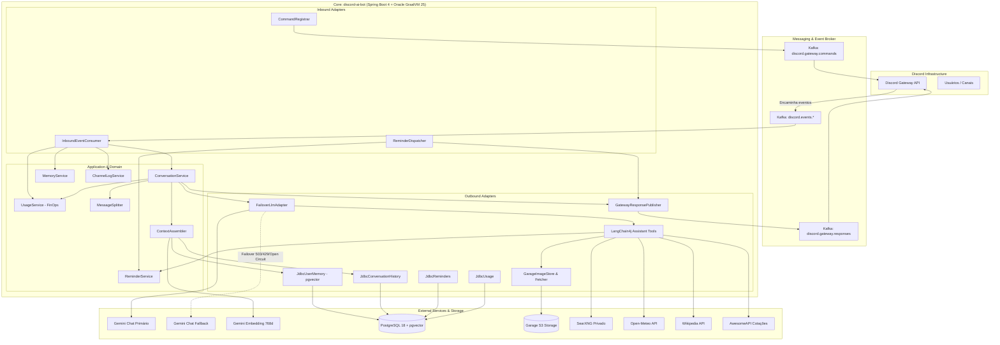
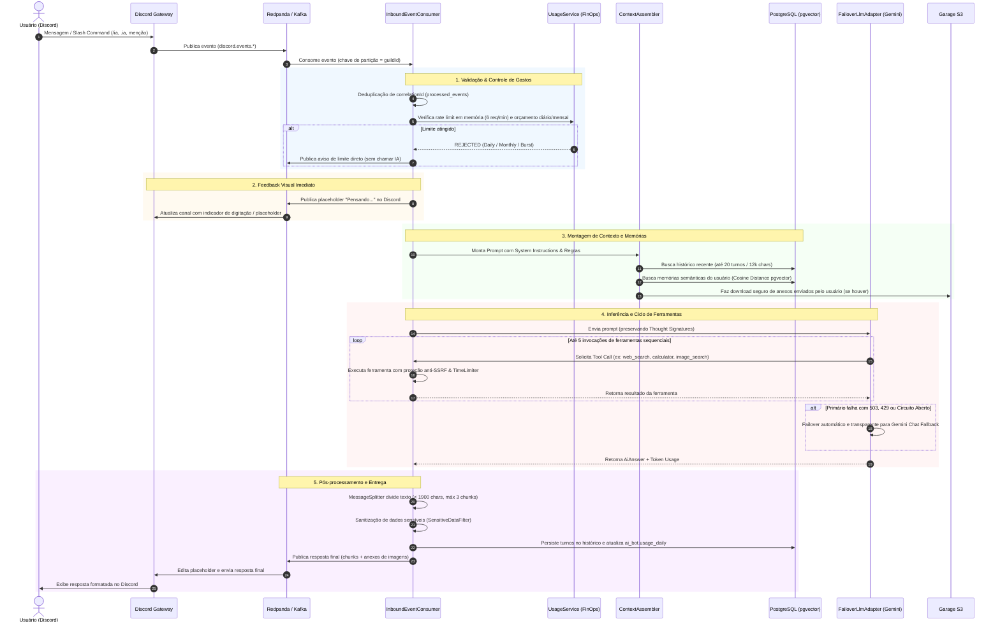

# 🤖 Discord AI Bot (HotBCT)

[](https://openjdk.org/)
[-JDK%2025-red?logo=graalvm)](https://www.graalvm.org/)
[](https://spring.io/projects/spring-boot)
[](https://github.com/langchain4j/langchain4j)
[](https://github.com/pgvector/pgvector)
[](https://kafka.apache.org/)
[](https://resilience4j.readme.io/)

O **Discord AI Bot (HotBCT)** é um serviço de inteligência artificial de alto desempenho, contextual e orientado a eventos para comunidades no Discord. Desenvolvido sobre o **Java 25 com Oracle GraalVM (GFTC)** e **Spring Boot 4**, ele adota os princípios de **Arquitetura Hexagonal (Ports and Adapters)** e integração assíncrona desacoplada via **Kafka / Redpanda**.

O bot integra os modelos de última geração da família **Google Gemini** com recuperação de memória vetorial de longo prazo (**pgvector**), ferramentas dinâmicas de busca e utilidades com proteção corporativa **anti-SSRF**, controle orçamentário granular (**FinOps**) e resiliência com failover automático.

---

## 🏛️ Blueprint da Arquitetura

O sistema opera de forma desacoplada do Discord: um gateway externo escuta a API de Gateway do Discord e publica eventos brutos no Kafka. O `discord-ai-bot` processa os eventos de maneira reativa e assíncrona, publicando as respostas formatadas em tópicos de saída.

### 📐 Diagrama de Componentes e Arquitetura Hexagonal



---

## ⚡ Fluxo de Execução Ponta a Ponta

Cada interação segue um pipeline rigoroso de validação, controle orçamentário, montagem de contexto, inferência e publicação:



---

## 🛠️ Ferramentas Integradas (LangChain4j Assistant Tools)

O assistente possui um conjunto de 10 ferramentas de alta precisão disponíveis para resolução dinâmica de problemas:

| Ferramenta | Descrição | Integração / Mecanismo | Resiliência & Segurança |
|---|---|---|---|
| `web_search` | Busca fatos recentes, notícias e informações da web atualizadas. | SearXNG privativo em cluster | CircuitBreaker (30s) + TimeLimiter (5s) |
| `image_search` | Busca imagens, faz download concorrente e anexa ao Discord. | SearXNG + `SafeImageDownloader` + `GarageImageStore` | Download paralelo, Anti-SSRF, limite de 4 imagens, 8 MiB |
| `read_url` | Lê e resume o conteúdo textual de links web fornecidos pelo usuário. | `SafePageReader` + Jsoup + Raw GitHub parser | Anti-SSRF completo, máx. 5 redirects, portas 80/443 |
| `channel_context` | Recupera mensagens recentes trocadas no canal para contexto. | `JdbcChannelLog` (`ai_bot.channel_messages`) | Filtro por canal, limite configurável de caracteres |
| `exchange_rate` | Cotações e conversão cambial de moedas fiduciárias e criptomoedas. | AwesomeAPI (`economia.awesomeapi.com.br`) | CircuitBreaker (60s) + TimeLimiter (5s) |
| `reminder` | Cria, lista e cancela lembretes programados no canal. | `JdbcReminders` + `ReminderDispatcher` | Scheduler a cada 10s via Kafka, fuso horário local |
| `calculator` | Avaliador matemático de alta precisão para expressões numéricas. | `ExpressionCalculator` (Parser próprio) | Seguro, sem motores de script, sem risco de injeção |
| `weather` | Condições climáticas e previsão do tempo de cidades globais. | Open-Meteo API | CircuitBreaker (60s) + TimeLimiter (4s) |
| `wikipedia` | Informações enciclopédicas estáveis e definições conceituais. | Wikipedia REST API v1 | CircuitBreaker (60s) + TimeLimiter (4s) |
| `save_memory` | Gravação voluntária de preferências e informações do usuário. | `JdbcUserMemory` + `GeminiEmbeddingAdapter` | Embedding 768d, Cosine Distance, dedup vetorial |

---

## 🛡️ Segurança Corporativa e Proteção Anti-SSRF

Ao interagir com a web aberta através de `read_url` e `image_search`, o bot aplica proteções rigorosas contra **Server-Side Request Forgery (SSRF)**:

1. **Validação Estrita de IPs de Destino (`SafeImageDownloader` / `SafePageReader`)**:
   - Resolução DNS inspecionada antes de abrir conexões.
   - Bloqueio imediato de endereços:
     - Loopback (`127.0.0.0/8`, `::1`)
     - Redes Privadas RFC 1918 (`10.0.0.0/8`, `172.16.0.0/12`, `192.168.0.0/16`)
     - Link-Local (`169.254.0.0/16`, `fe80::/10`)
     - Carrier-Grade NAT (CGNAT `100.64.0.0/10`)
     - Unique-Local IPv6 (`fc00::/7`) e Multicast (`224.0.0.0/4`, `ff00::/8`)
2. **Validação em Cada Salto de Redirecionamento**:
   - Não utiliza redirect automático de HTTP client; cada salto (até 3 para imagens, 5 para páginas) é validado independentemente contra o resolvedor anti-SSRF.
3. **Restrição Estrita de Portas e Esquemas**:
   - Permite unicamente `http` e `https` nas portas padronizadas `80` e `443`. Credenciais embutidas na URL (`userinfo`) são rejeitadas.
4. **Inspeção de Formato por Magic Bytes**:
   - O tipo de imagem nunca é inferido por extensão de URL ou pelo cabeçalho `Content-Type`. Os primeiros bytes do payload são analisados para confirmar os magic numbers de formatos legítimos (`PNG`, `JPEG`, `GIF`, `WEBP`).

---

## 💰 Governança de Custos e Rate Limiting (FinOps)

O bot conta com um sistema multicamadas de controle de custos para prevenir abusos e garantir previsibilidade financeira:

- **Burst Limiter em Memória**:
  - Limite de até **6 requisições por minuto** por usuário, verificado em memória antes de qualquer chamada a banco ou IA.
- **Limites Diários do Usuário**:
  - Máximo de **150 requisições diárias** ou teto de gasto de **US$ 5,00/dia**.
- **Limites Mensais**:
  - Teto individual de **US$ 10,00/mês** por usuário.
  - Orçamento global do bot fixado em **US$ 20,00/mês**.
- **Contabilização Fiel de Tokens & Thinking**:
  - Acúmulo em micros-USD na tabela `ai_bot.usage_daily`.
  - Contabilização explícita de *Thinking Tokens* gerados pelos modelos Gemini 3.
  - Cobrança precisa diferenciando modelos de entrada e modelos fallback.
- **Comando `/ia-limites`**:
  - Slash command efêmero que detalha o consumo do usuário, porcentagem do orçamento global consumida e horários exatos de reset de limites, sem consumir chamadas ao LLM.

---

## 🔄 Resiliência e Failover Transparente

- **Failover Automático de LLM (`FailoverLlmAdapter`)**:
  - Caso o modelo principal retorne `HTTP 503` (High Demand), `HTTP 429` (Rate Limit) ou acione o Circuit Breaker, a requisição é reexecutada do zero no modelo de fallback (ex.: `gemini-3.5-flash`).
  - Instâncias isoladas de `CircuitBreaker` e `TimeLimiter` para o modelo principal e o fallback, impedindo que a instabilidade de um afete o outro.
- **Suporte a Gemini Thought Signatures**:
  - Configuração nativa `returnThinking(true)` e `sendThinking(true)` para que chamadas subsequentes com resultados de ferramentas não sejam rejeitadas com `HTTP 400`.
- **Drenagem Graciosa no Desligamento (Graceful Shutdown)**:
  - O `InboundEventConsumer` aguarda a conclusão de conversas em trânsito (timeout padrão de 95s) antes de desativar os recursos, evitando respostas cortadas em deploys e reinicializações.
- **Health Checks Eficientes**:
  - O `KafkaHealthIndicator` reutiliza uma instância única de `AdminClient`, eliminando floods desnecessários nos logs de auditoria do Kubernetes.

---

## ⚡ Runtime de Alta Performance com Oracle GraalVM (GFTC) e Java 25

O serviço é empacotado em container Docker otimizado para produção sobre o **Oracle GraalVM JDK 25** sob licença **GFTC (GraalVM Free Terms and Conditions)**:

```dockerfile
FROM container-registry.oracle.com/graalvm/jdk:25 AS runtime
```

### Configurações de JVM e Concorrência:
- **Oracle GraalVM Enterprise JIT**:
  - `-XX:+UnlockExperimentalVMOptions -XX:+EnableJVMCI -XX:+UseJVMCICompiler`: Ativa o compilador GraalVM JIT no topo da JVM.
  - `-Djdk.graal.CompilerConfiguration=enterprise`: Habilita o pipeline de otimizações enterprise da Oracle para máximo throughput computacional.
  - `-Djdk.graal.Vectorization=true`: Vetorização SIMD automática (aceleração de embeddings vetoriais, cálculos de distância e JSON).
  - `-Djdk.graal.UsePriorityInlining=true`: Heurística avançada de inlining por prioridade, otimizando pipelines reativos e closures do LangChain4j.
  - `-XX:+TieredCompilation`: C1 (Tiers 1-3) para inicialização rápida do container + GraalVM JIT (Tier 4) para processamento contínuo.
- **Generational ZGC (`-XX:+UseZGC`)**:
  - Coletor de lixo de ultra-baixa latência nativo no JDK 25, com pausas garantidas abaixo de 1 milissegundo (<1ms), eliminando congelamentos durante streaming de IA.
- **Compact Object Headers (`-XX:+UseCompactObjectHeaders`)**:
  - Reduz cabeçalhos de objetos de 12/16 bytes para 8 bytes, economizando de 10% a 20% de memória heap em árvores de contexto conversacional e DTOs.
- **Memória Otimizada para Containers (`-XX:MaxRAMPercentage=75.0` e `-XX:+AlwaysPreTouch`)**:
  - Aloca 75% da RAM do container para a heap Java, reservando 25% para off-heap, Metaspace e JIT, pré-mapeando as páginas de memória para evitar stalls de page-fault.
- **DNS Dinâmico no Kubernetes**:
  - `-Dnetworkaddress.cache.ttl=30`: Resolução de nomes dinâmica para serviços dependentes (Consul, Redpanda, PostgreSQL pgvector).
- **Virtual Threads (Project Loom)**:
  - Habilitadas globalmente (`spring.threads.virtual.enabled: true`), permitindo escalabilidade massiva de chamadas bloqueantes de I/O (REST Gemini, SearXNG, JDBC pgvector, S3, Kafka) sem esgotamento de threads do sistema operacional.

---

## 📋 Comandos Disponíveis no Discord

| Comando | Tipo | Visibilidade | Descrição |
|---|---|---|---|
| `/ia <pergunta>` | Slash Command | Pública | Envia uma pergunta estruturada para a IA. |
| `.ia <pergunta>` | Mensagem / Prefixo | Pública | Envia uma pergunta via chat, com suporte direto a anexos de imagem. |
| `@HotBCT <pergunta>` | Menção no Chat | Pública | Conversa direta com o bot em qualquer canal permitido. |
| *Responder à mensagem* | Reply no Chat | Pública | Respostas a mensagens enviadas pelo bot continuam o contexto da conversa. |
| `/ia-memoria <acao> [id]` | Slash Command | Efêmera | Gerencia o que a IA lembra sobre você (`listar`, `esquecer`, `esquecer-tudo`). |
| `/ia-limites` | Slash Command | Efêmera | Exibe o consumo atual de requisições, custos e cotas disponíveis. |

---

## ⚙️ Variáveis de Ambiente e Configurações

| Variável | Padrão | Descrição |
|---|---|---|
| `GEMINI_API_KEY` | *(Obrigatório)* | Chave de API do Google Gemini. |
| `GEMINI_CHAT_MODEL` | `gemini-3.5-flash-lite` | Modelo principal de chat. |
| `GEMINI_FALLBACK_CHAT_MODEL` | *(Opcional)* | Modelo secundário para failover automático em caso de sobrecarga (ex: `gemini-3.5-flash`). |
| `GEMINI_TEMPERATURE` | `1.0` | Temperatura de amostragem do modelo Gemini. |
| `SPRING_KAFKA_BOOTSTRAP_SERVERS` | `redpanda...:9093` | Endereço dos brokers Kafka / Redpanda. |
| `SEARXNG_URL` | `http://searxng...:8080` | Endpoint da instância privada do SearXNG. |
| `GARAGE_ENDPOINT` | `http://garage...:3900` | Endpoint compatível com S3 (Garage Storage) para upload/download de mídias. |
| `GARAGE_BUCKET` | `discord-gateway-attachments` | Bucket S3 para armazenar anexos e imagens processadas. |
| `GARAGE_ACCESS_KEY` / `GARAGE_SECRET_KEY` | - | Credenciais de acesso ao storage S3. |
| `SPRING_CLOUD_CONSUL_HOST` | `consul-server...` | Host do HashiCorp Consul para configuração centralizada dinâmica. |
| `HIKARI_MAX_POOL_SIZE` | `20` | Tamanho máximo do pool de conexões com o PostgreSQL. |

---

## 🚀 Como Executar

### Pré-requisitos
- **Java 25** (Oracle GraalVM JDK 25 recomendado)
- **Docker** e **Docker Compose**
- PostgreSQL 18 com extensão **pgvector**
- Cluster Kafka / Redpanda acessível

### Build e Testes
```bash
# Executar todos os testes de unidade e integração (usa Testcontainers para Postgres e Redpanda)
./gradlew test

# Gerar o artefato JAR executável
./gradlew bootJar
```

### Construção da Imagem Docker
```bash
docker build -t discord-ai-bot:latest .
```

### Execução Local via Docker
```bash
docker run -d \
  --name discord-ai-bot \
  -p 8080:8080 \
  -e GEMINI_API_KEY="sua_chave_aqui" \
  -e GEMINI_CHAT_MODEL="gemini-3.5-flash-lite" \
  -e SPRING_KAFKA_BOOTSTRAP_SERVERS="localhost:9092" \
  -e SPRING_DATASOURCE_URL="jdbc:postgresql://localhost:5432/discord_bot" \
  -e SPRING_DATASOURCE_USERNAME="postgres" \
  -e SPRING_DATASOURCE_PASSWORD="senha" \
  discord-ai-bot:latest
```

---

## 📊 Observabilidade e Métricas

O serviço expõe métricas completas no padrão Prometheus e traces via OpenTelemetry:
- **Health Probes**: `/actuator/health` com probes dedicadas para `liveness` e `readiness` (checando conexão viva com PostgreSQL e Kafka).
- **Métricas Prometheus**: `/actuator/prometheus` contendo métricas de latência por estágio (`stage=assemble`, `stage=llm`, `stage=publish`, `stage=total`), contagem de tokens de entrada e saída, e status de circuitos (`resilience4j.circuitbreaker.*`).
- **Distributed Tracing**: Exportação OTLP habilitada via `OTEL_EXPORTER_OTLP_ENDPOINT`.
